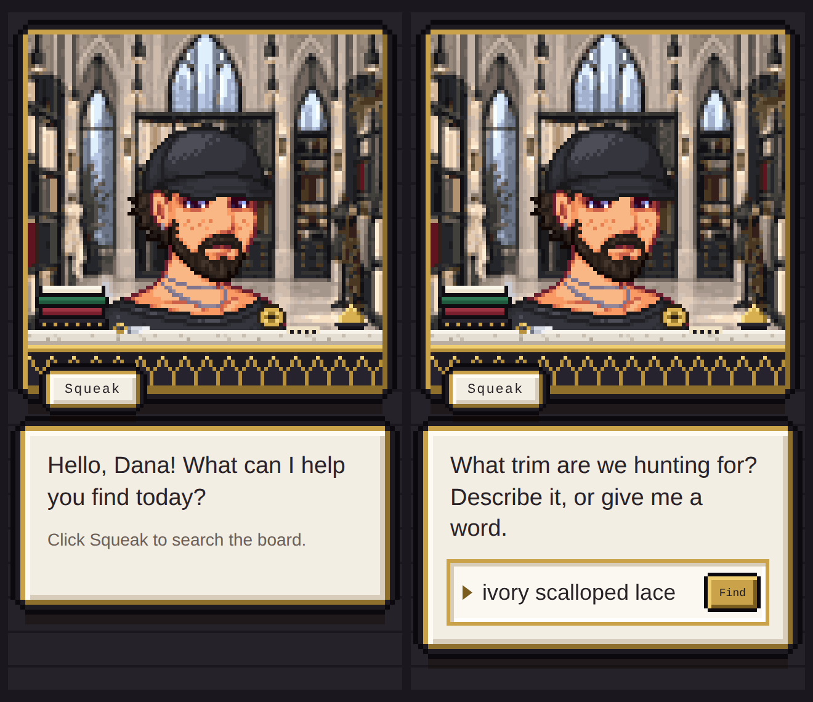

# Squeak – Trim Finder for Miro

A 16-bit shopkeeper who lives in your Miro board's side panel. Squeak greets everyone who walks in, and when you click him and describe a trim ("ivory scalloped lace", "red pom-poms", "zigzag ribbon"), he finds it on the board, holds it up, and flies your view right to it.


## What Squeak does

- **Greets people as they arrive.** On the board you choose as his home, Squeak's panel opens for everyone who comes in, and he says hello by name, then asks what he can help them find today. On other boards he stays out of the way until someone clicks his icon.
- **Listens when you click him.** A search box opens inside his dialogue box. Type a word or a loose description.
- **Actually looks at your trims.** Squeak uses in-browser image recognition (a fashion-trained CLIP model) to label every photo on the board. He knows about 60 kinds of item:
  - **Trims and ribbons:** *lace, rickrack, pom-pom, sequin, velvet ribbon…*
  - **Beads:** *seed, bugle, faceted, trapezoid…*
  - **Metal hardware:** *rings, D-rings, buckles, grommets, snaps, clasps…*
  - **Buttons and embellishments.**

  He names shapes for beads, buttons and charms, and measures colors from the photo's actual pixels. When he isn't sure of the exact type, he says the broader family ("bead", "metal hardware") instead of guessing. He saves what he learns on the board itself, so each photo is only ever looked at once, and every visitor's Squeak is ready instantly on reload. iPhone **HEIC** photos work too: Squeak converts them in the browser.
- **Only looks at the top layer.** Photos that have another photo sitting on top of them, like backdrops behind your frames or old photos stacked under new ones, are ignored. The name of the frame a photo sits on is searchable too, so a photo on a frame called "Bridal Lace" turns up for "bridal".
- **Learns from you.** If he labels something wrong, choose **Fix this label** and tell him what it really is. He saves it with the photo, searches by it, and uses it from then on.
- **Finds and shows.** He holds up the best match, asks if you'd like a closer look, and zooms the board to it. You can flip through other matches or click any result directly.
- **Has some life to him.** He blinks, breathes and talks. When you search, he ducks behind his counter and rummages, tossing spools, buttons and ribbon over the edge, then comes back up gripping a square frame that shows the trim he found as a sharp, full-resolution photo. Ask for the next one and he puts it back under the desk and pulls up another. The city outside the atelier windows follows the time of day.



---

## Use Squeak on your Miro board

If someone already hosts Squeak, they'll give you an installation link:

1. Open the link, choose the Miro team you want Squeak in, and approve the permissions.
2. Open the board where your trims live. In the toolbar on the left, click **+**, search `trim`, and click **Trim Finder**.
3. In Squeak's panel, tick **Show Squeak to everyone who opens this board**. From now on, he pops up on that board for everyone, every time it's opened or reloaded. Anyone who can edit the board can switch this on or off for everyone, and you can turn it on for as many boards as you like.

<!-- Maintainers: after setup, replace the line below with your Miro installation URL. -->
**Install link:** *add your Miro installation URL here*

---

## Publish your own copy

Squeak is a plain static website: no server, no build step, no accounts. GitHub Pages can host it for free. Setup takes about 15 minutes.

### 1. Put the code on GitHub

**In the browser (no tools needed):**

1. On GitHub, create a **New repository** named `squeak-trim-finder`, set it to **Public**, and create it.
2. On the empty repo page, click **uploading an existing file**.
3. Drag in **everything inside** this folder (the files and the `assets`, `docs` and `miro` folders, not the outer folder itself), then click **Commit changes**.

**Or with git:**

```bash
cd squeak-trim-finder
git init
git add .
git commit -m "Squeak the trim finder"
git branch -M main
git remote add origin https://github.com/YOUR-GITHUB-USERNAME/squeak-trim-finder.git
git push -u origin main
```

### 2. Turn on GitHub Pages

1. In the repo, go to **Settings → Pages**.
2. Under **Build and deployment**, set **Source** to **Deploy from a branch**, choose **main** and **/ (root)**, and click **Save**.
3. After a minute or two, your site is live at
   `https://YOUR-GITHUB-USERNAME.github.io/squeak-trim-finder/`

Free GitHub accounts can use Pages with public repositories.

### 3. Point the manifest at your site

Open `miro/app-manifest.yaml` and replace `YOUR-GITHUB-USERNAME` in `sdkUri` with your GitHub username. If you renamed the repo, change `squeak-trim-finder` too. `miro/manifest.json` contains the same settings, if you prefer JSON.

### 4. Create the Miro app

1. If you don't have one yet, create a free **Developer team** at <https://miro.com/app/dashboard/?createDevTeam=1>. Miro requires apps to be created inside one.
2. Switch to the Developer team, open **Profile settings → Your apps**, and create a new app.
3. In the app's settings, open the **app manifest** editor, replace its contents with `miro/app-manifest.yaml`, and save.
4. Install the app into your Developer team and open a board there to check that Squeak appears.

Boards in a Developer team show a "developer" watermark. That's normal, and it won't appear for people who install Squeak into their regular teams.

### 5. Share it

On your app's settings page, scroll to **Share app** and copy the **Installation URL**. Anyone with that link can install Squeak into their own Miro team. A Marketplace listing isn't required. Paste the link into the **Install link** line near the top of this README.

---

## Run it locally

Browsers won't run Squeak if you double-click `app.html`, because it uses JavaScript modules, which must be served over `http://`. From this folder, run:

```bash
python3 -m http.server 3000      # Windows: py -m http.server 3000
```

- **Preview Squeak:** open <http://localhost:3000/app.html>. Outside Miro he runs in *preview mode*: he greets you and animates, and explains that there's no board to search.
- **Test inside Miro:** create a second Miro app whose manifest uses `sdkUri: http://localhost:3000` (Miro allows plain HTTP on localhost), install it in your Developer team, and keep the server running while you test.

---

## How it works

| File | What it does |
| --- | --- |
| `index.html` | The entry point Miro loads invisibly when a board opens. It opens Squeak's panel for each arriving person (once per browser tab) and handles the toolbar icon. |
| `app.html` | The side panel: the atelier scene, dialogue box, search box and results. The color palette is at the top of the `<style>` block. |
| `app.js` | Squeak's brain: animation, greetings, search, cataloguing photos, and zooming the board. Tunable settings live in `CONFIG` at the top. |
| `lines.js` | Everything Squeak says, with several variations for each moment. |
| `trims.js` | The trim vocabulary: types, colors and the synonyms people type. |
| `vision-worker.js` | Image recognition ([Marqo FashionCLIP](https://huggingface.co/Marqo/marqo-fashionCLIP) through [Transformers.js](https://huggingface.co/docs/transformers.js)), running in a background thread so the animation stays smooth. |
| `assets/` | Pixel art: Squeak's animation frames, the atelier at four times of day, and the counter. |
| `miro/` | The Miro app manifest, in YAML (what Miro's editor expects) and JSON. |

**Search** combines three signals:
- words in sticky notes, text, cards, shapes, image titles, alt text and frame titles;
- Squeak's auto-generated tags and their synonyms;
- visual similarity between your description and each photo.

Squeak tells you which kind of match he found: "Got one" when every word matched, "Nothing matches every word, but…" for partial matches, and "I'm not totally sure…" when he's going only by how the photos look.

**Photos Squeak catalogues:** only photos on the top layer, meaning ones that no other photo sits on top of (a photo counts as "on top" when at least half of it overlaps the one below). HEIC photos are converted to JPEG in the browser. If a photo can't be converted, Squeak uses Miro's smaller preview copy instead. His status sign reports how many photos he catalogued, skipped, or couldn't read.

---

## Customize Squeak

- **What he says:** edit `lines.js`. Placeholders such as `{name}`, `{query}` and `{thing}` are filled in automatically.
- **Item types, shapes, colors and synonyms:** edit `trims.js`. After changing the vocabulary, bump `TAGGER_VERSION`. Squeak then relabels every photo the next time he opens. It's quick: he reuses each photo's saved fingerprint, so he doesn't have to look at the photos again.
- **How sure Squeak must be before using a specific word:** the `TAGGING` thresholds in `trims.js`. Raise them for fewer but safer labels, or lower them for more specific ones.
- **Matching sensitivity:** in `app.js`, `CONFIG.semantic.minLift` and `floor` control how confident a visual match must be. Raise them if Squeak suggests trims that don't fit; lower them if he misses ones that do.
- **Where he pops up by himself:** tick **Show Squeak to everyone who opens this board** in Squeak's panel on each board you want. The setting is saved on the board and shared by everyone on it. To change the overall behavior, edit `AUTO_OPEN` in `index.html`:
  - `'home'` (the default): only on ticked boards.
  - `'all'`: every board.
  - `'none'`: only when someone clicks his icon.
- **Write tags into image alt text:** set `CONFIG.writeAltText = true` in `app.js`. This fills empty alt text with Squeak's description; everyone on the board can see it.
- **Rename him:** change the nameplate text in `app.html` (`<div class="nameplate frame" …>Squeak</div>`) and `appName` in the manifest.
- **Colors:** the palette tokens at the top of `app.html` (black lacquer, gold and marble cream by default).
- **Art:** the scene is a 96×96 pixel canvas drawn at 3×.
  - `assets/squeak-portrait.png` holds 12 frames of 64×64 in a row. Frame order is eyes (open, closed, happy) × mouth (closed, o, open, grin), so frame index = `eyes × 4 + mouth`.
  - The background has one image per time of day: `atelier-morning.png`, `atelier-day.png`, `atelier-evening.png` and `atelier-night.png`.
  - `counter.png` is drawn in front of Squeak.

---

## Privacy and permissions

- **No server, no tracking.** Squeak is a static site. There's no backend, database, analytics or login.
- **Photos never leave the browser.** Image recognition and HEIC conversion run on the viewer's own computer. The browser downloads the Transformers.js library from jsDelivr, the FashionCLIP model from Hugging Face (about 150 MB, cached after the first time), and, only if HEIC photos turn up, the heic2any converter from jsDelivr.
- **`boards:read`:** lets Squeak list board items and read trim photos so he can search and tag them.
- **`boards:write`:** lets Squeak save his catalogue (tags plus a compact image fingerprint per photo) in two native Miro places: the board's **app storage**, which loads the whole catalogue in a few calls, and each photo's **app metadata**, which travels with the photo when a board is duplicated. Only this app can see that data, and it doesn't change how the photos look.
- **This browser:** Squeak also keeps a copy of the catalogue in your browser (IndexedDB). Reloads are instant, and it still works for people with view-only access, who can't save to the board.

---

## Troubleshooting

| Problem | Fix |
| --- | --- |
| Blank panel when opening `app.html` from your computer | Serve the folder over `http://` (see **Run it locally**). |
| Squeak doesn't show up for a teammate | They need to open the installation link, install Squeak into *their* team and approve the permissions. The board must belong to that team. |
| The panel closes when you click the board | Click the pin icon at the top of the panel to keep Squeak open. |
| "Loading image recognition…" on first use | The model is downloading once for this browser. Later visits load it from the cache. |
| Keyword search works, but describing a trim doesn't | The network may block `cdn.jsdelivr.net` or `huggingface.co`. Squeak falls back to names, labels and existing tags. |
| He suggests trims that don't match, or misses ones that do | Tune `CONFIG.semantic` in `app.js`, or add synonyms in `trims.js`. |
| He seems to catalogue everything again after a reload | His sign should say "N trims ready" within a second. If it says "saved on this computer only", Miro refused to save to the board. Check you have edit access, and look in the browser console (F12) for lines starting with `[Squeak]`. |
| His sign says some photos "couldn't be read" | Those files are damaged or in an unusual format. Re-upload them as JPEG or PNG. |
| A trim photo is being skipped | Another photo is sitting on top of it. Move it out from under the other photo, or bring it to the front. |
| Your changes don't appear after pushing | GitHub Pages takes a minute or two to update. Then hard-refresh the board (Ctrl/Cmd + Shift + R). |

---

## Credits and license

**Code:** MIT License; see [`LICENSE`](LICENSE).

**Artwork in `assets/` and `docs/`:** the character portrait and the atelier backdrop are **not** covered by the MIT license. All rights are reserved by their respective owners.
<!-- Maintainers: credit the artwork here, e.g.
- Character portrait: © YOUR NAME (or the artist's name and link)
- Atelier backdrop: © YOUR NAME (or source and license)
-->

**Built with:**
- [Miro Web SDK](https://developers.miro.com/docs/miro-web-sdk-introduction)
- [Transformers.js](https://github.com/huggingface/transformers.js) (Apache-2.0)
- [Marqo FashionCLIP](https://huggingface.co/Marqo/marqo-fashionCLIP) (Apache-2.0)
- [heic2any](https://github.com/alexcorvi/heic2any) (MIT)
- [Pixelify Sans](https://fonts.google.com/specimen/Pixelify+Sans) and [Press Start 2P](https://fonts.google.com/specimen/Press+Start+2P) (SIL Open Font License)
